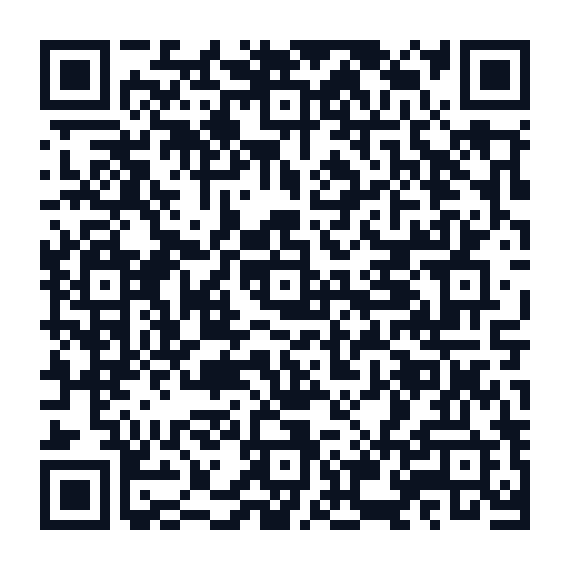
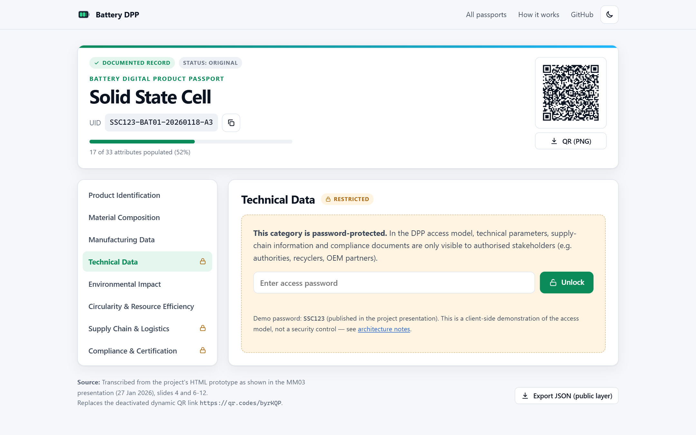
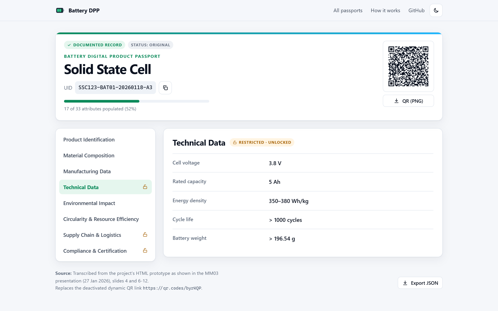
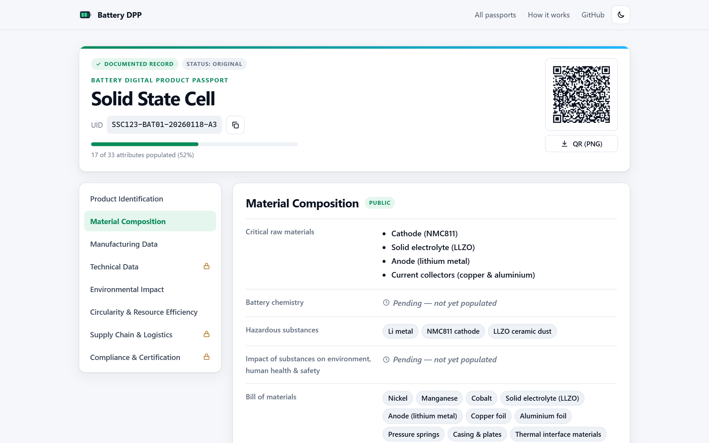
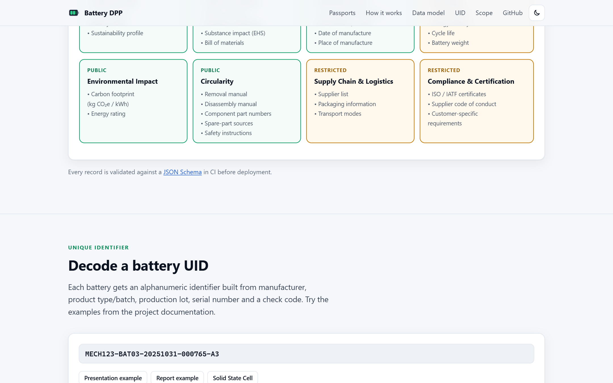
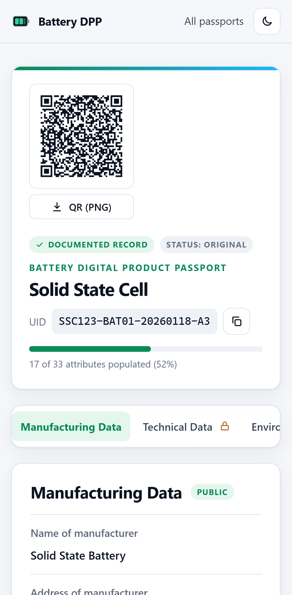
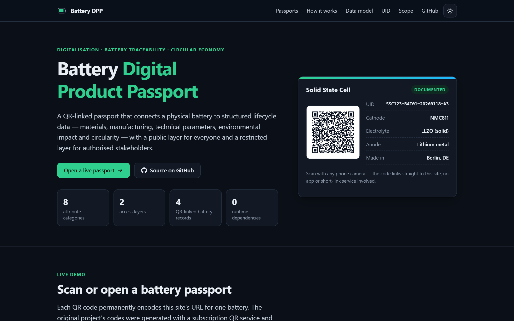
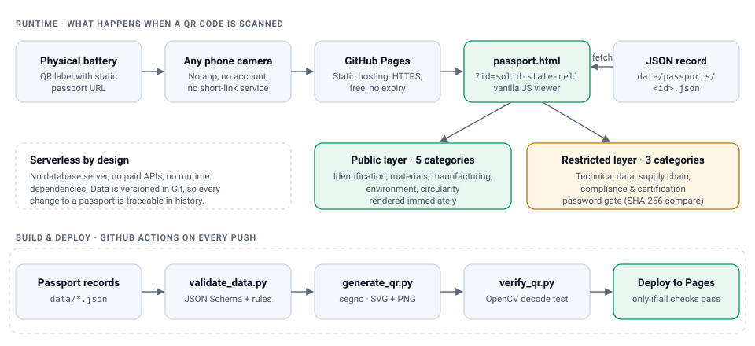

<div align="center">

# 🔋 Battery Digital Product Passport

**A QR-linked Digital Product Passport (DPP) for batteries. Eight attribute categories, public and restricted access layers, permanent self-hosted QR codes. Modelled on the battery passport concept in the EU Battery Regulation.**

[](https://github.com/Kiran-koppera/digital-product-passport/actions/workflows/ci-deploy.yml)


### [▶ Live demo](https://kiran-koppera.github.io/digital-product-passport/) · [Open a passport](https://kiran-koppera.github.io/digital-product-passport/passport.html?id=solid-state-cell) · [Architecture](docs/architecture.md) · [Data model](docs/data-model.md)


</div>

---

## Overview

From 18 February 2027, [Regulation (EU) 2023/1542](https://eur-lex.europa.eu/eli/reg/2023/1542/oj) requires every
EV battery, every light-means-of-transport battery and every industrial battery above 2 kWh placed on the EU market to
have an electronic **battery passport** that can be reached through a QR code. The passport carries data on
materials, carbon footprint, supply chain, performance and end-of-life handling.

This project designs and prototypes such a passport:

- a **unique identifier** scheme for individual batteries
- an **attribute model** of 8 categories, derived from the Battery Pass consortium's content guidance
- a **layered access model**: public data for consumers and recyclers, restricted data for authorised stakeholders
- a **web interface** reached by scanning a **QR code** on the battery

It started as a four-person team project at HTW Berlin (January 2026). This repository rebuilds the prototype as a
deployed, tested demo, and fixes the QR codes that stopped working when the original QR vendor's subscription expired.

## Try it

| Scan with your phone | Battery | Record |
|:-:|---|---|
|  | **[Solid State Cell](https://kiran-koppera.github.io/digital-product-passport/passport.html?id=solid-state-cell)**<br>`SSC123-BAT01-20260118-A3`<br>NMC811 cathode · LLZO solid electrolyte · Li-metal anode | ✅ Documented (17 / 33 attributes) |
|  | **[Lithium Ion Battery](https://kiran-koppera.github.io/digital-product-passport/passport.html?id=lithium-ion-battery)** | ⏳ Placeholder |
|  | **[Sodium Ion Cell](https://kiran-koppera.github.io/digital-product-passport/passport.html?id=sodium-ion-cell)** | ⏳ Placeholder |
|  | **[Sodium Chloride Battery](https://kiran-koppera.github.io/digital-product-passport/passport.html?id=sodium-chloride-battery)** | ⏳ Placeholder |

> **Restricted categories:** Technical Data, Supply Chain & Logistics, and Compliance & Certification need the demo
> password **`SSC123`**, as published in the project presentation.
>
> **Placeholder records:** the project presentation listed four batteries with QR codes, but attribute data was only
> documented for the Solid State Cell. The other three keep their QR codes and the full attribute structure, so they
> can be filled in without code changes.

## Features

| | Feature | Details |
|---|---|---|
| 📱 | **QR → passport in one scan** | Each QR code encodes the final URL directly. No app, no short-link service, nothing that can expire. |
| 🗂️ | **8-category attribute model** | Identification, materials, manufacturing, technical, environmental, circularity, supply chain, compliance. |
| 🔐 | **Layered access** | 5 public and 3 restricted categories. Password gate using Web Crypto SHA-256. The unlocked state lasts for the browser session. |
| 📊 | **Data completeness** | Each passport shows how many attributes are populated. Missing values appear as *Pending*, never as invented data. |
| 🧾 | **Access-aware JSON export** | Downloads the record. Restricted sections are redacted unless the passport is unlocked. |
| 🏷️ | **Printable labels** | [labels.html](https://kiran-koppera.github.io/digital-product-passport/labels.html) prints QR labels for every battery. |
| 🔎 | **UID decoder** | Splits an identifier into manufacturer, type/batch, production lot, serial number and check code. |
| ♿ | **Accessible & responsive** | Keyboard-navigable ARIA tabs, deep links per category, light/dark theme, tested on desktop and mobile. |
| ✅ | **Tested pipeline** | JSON Schema validation, QR decode tests, 30 Playwright tests, and a live HTTP check after every deployment. |

<table>
<tr>
<td width="50%"><br><sub>Restricted category before unlocking</sub></td>
<td width="50%"><br><sub>After entering the access password</sub></td>
</tr>
<tr>
<td><br><sub>Public layer: material composition</sub></td>
<td><br><sub>UID decoder</sub></td>
</tr>
</table>

<p align="center">&nbsp;&nbsp;</p>

## Architecture



The site is a **static, serverless** application. Plain HTML, CSS and ES modules are served by GitHub Pages, and
each battery's passport is a JSON file in this repository. Every change to a passport is therefore versioned,
reviewable and traceable in Git history. A GitHub Actions pipeline validates the data, checks that the QR codes
are current and decode correctly, runs browser tests, deploys, and then smoke-tests the live QR targets.

More detail: [docs/architecture.md](docs/architecture.md).

## Data model


The categories follow section 4.3 of the project report. Each record is validated against a
[JSON Schema](data/schema/passport.schema.json). Field provenance and the UID scheme are documented in
[docs/data-model.md](docs/data-model.md).

**Unique identifier**: `MECH123-BAT03-20251031-000765-A3` = manufacturer ID · product type / batch code ·
production lot (date) · serial number · check code.

## The QR code problem and the fix

The original prototype used a commercial *dynamic* QR service. Its codes encoded vendor short links
(`qr.codes/…`, `qr.link/…`) that redirected to the actual pages. When the subscription ended, all four links were
deactivated with the message *"The QR code owner needs to choose a plan to reactivate this QR code."*

The replacement codes are generated with the open-source [segno](https://github.com/heuer/segno) library and encode
the permanent GitHub Pages URL directly. They use QR version 8 with error correction level Q (about 25 % damage
tolerance). Every build checks that each code decodes to exactly the right URL, including when downscaled to
160 px. After deployment, a second check confirms that each target returns HTTP 200.
See [docs/qr-codes.md](docs/qr-codes.md).

## Tech stack

| Layer | Technology |
|---|---|
| Frontend | HTML5, CSS (custom properties, grid, `prefers-color-scheme`), vanilla JavaScript ES modules, Web Crypto API |
| Data | JSON + JSON Schema (draft 2020-12) |
| Tooling | Python 3.12 (segno, OpenCV, jsonschema) |
| Testing | Python `unittest`, Playwright (desktop Chrome + Pixel 7 emulation) |
| CI/CD & hosting | GitHub Actions → GitHub Pages |

## Getting started

```bash
git clone https://github.com/Kiran-koppera/digital-product-passport.git
cd digital-product-passport
python -m http.server 8000          # open http://localhost:8000
```

Development tooling:

```bash
pip install -r requirements-dev.txt
python scripts/validate_data.py     # validate all passport records
python scripts/generate_qr.py       # regenerate QR codes from the registry
python scripts/verify_qr.py         # decode-test every QR code (add --online for the live site)
python -m unittest discover -s tests

npm ci && npx playwright install chromium
npx playwright test                 # 30 end-to-end tests, desktop + mobile
```

Add a new battery with `python scripts/new_passport.py <id> "<Name>"`. Deployment and setup for a different
repository are covered in [docs/deployment.md](docs/deployment.md).

## Project structure

```
├── index.html, passport.html, labels.html, 404.html   # the site
├── assets/{css,js,img}/                               # styles, ES modules, icon
├── data/
│   ├── passports.json                                 # registry + demo access hash
│   ├── passports/*.json                               # one record per battery
│   └── schema/passport.schema.json
├── qr/                                                # generated QR codes (SVG + PNG)
├── scripts/                                           # scaffold, validate, generate & verify QR, screenshots
├── tests/                                             # Python unit tests + Playwright e2e
├── docs/
│   ├── architecture.md, data-model.md, qr-codes.md, deployment.md
│   ├── images/                                        # diagrams, screenshots, original prototype screenshots
│   └── original/                                      # milestone report + presentation (PDF)
├── legacy/prototype-v0.html                           # earliest single-page prototype, kept unchanged
└── .github/workflows/ci-deploy.yml
```

## Scope: implemented vs. proposed

| Capability | Status |
|---|---|
| Passport viewer, 8 categories, 4 QR-linked records | ✅ Implemented |
| Permanent QR codes with automated decode verification | ✅ Implemented |
| Layered public / restricted access | ✅ Implemented as a **client-side demo**. Static hosting cannot protect data; the JSON is public. |
| JSON Schema validation, CI/CD, browser tests | ✅ Implemented |
| UID format decoder | ✅ Implemented. The check-code algorithm was not defined in the project; a CRC-8 proposal is shown and labelled as an extension. |
| Complete data for all batteries | ⚠️ Partial: Solid State Cell 17 / 33 attributes, others are placeholders |
| Data entry / editing forms | ⚠️ In the original prototype only; here, records are edited as JSON through pull requests |
| Real authentication with role-based access (authorities, recyclers, OEMs) | 🔭 Proposed: needs a server-side identity provider |
| Lifecycle updates during use, repurposing and recycling (e.g. from BMS data) | 🔭 Proposed |
| Legal compliance with Regulation (EU) 2023/1542 / Annex XIII | ❌ Not claimed: the categories follow the regulation's intent, but the full mandatory data set and verification are not covered |

## Challenges identified in the project

From the milestone report:

1. Ensuring that all required data is complete and verified.
2. Managing sensitive information and confidentiality obligations.
3. Integrating an HTML front end with a web-based database.
4. Keeping data consistently updated over the product lifecycle.

## Credits

Team project in the module *M7 Manufacturing Technology and Business Technology*, HTW Berlin. Milestone
report dated 22 January 2026; presentation dated 27 January 2026.
**Team:** Shubham Kanawade, Sanchay Narain, Varad Shinde, Kiran Koppera. **Supervisor:** Prof. Dr. Christoph Sprung.

Original documents: [milestone report](docs/original/DPP_MM03_Milestone-Report_2026-01-22.pdf) ·
[presentation](docs/original/DPP_MM03_Presentation_2026-01-27.pdf) ·
[original interface screenshots](docs/images/original-prototype/).

Portfolio rebuild (static site, QR replacement, data pipeline, tests, CI/CD) by Kiran Koppera.

**References:** [Battery Pass – Content Guidance (2023)](https://thebatterypass.eu/assets/images/content-guidance/pdf/2023_Battery_Pass_Content_Guidance.pdf) ·
[Global Battery Alliance – Battery Passport](https://www.globalbattery.org/battery-passport/) ·
[Regulation (EU) 2023/1542](https://eur-lex.europa.eu/eli/reg/2023/1542/oj)

## License

Code: [MIT](LICENSE). The documents in `docs/original/` are the project team's academic work and are included for
reference only.
