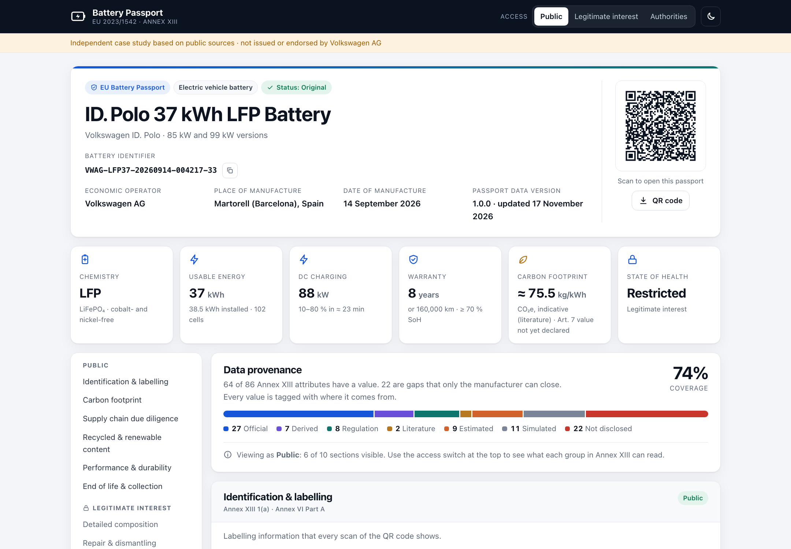
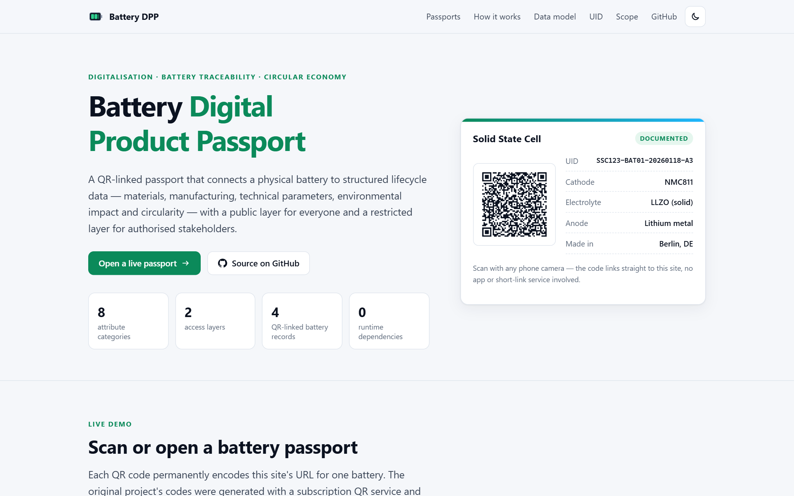
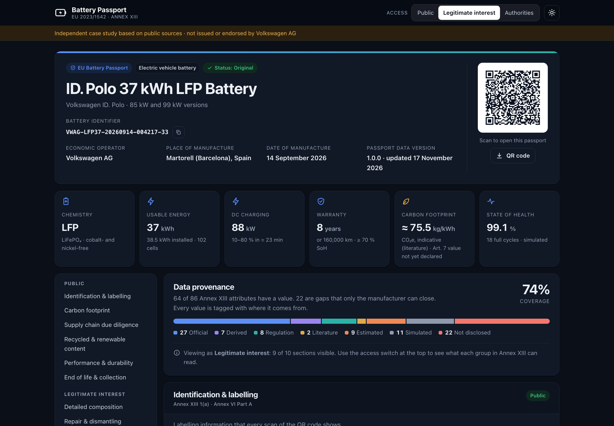
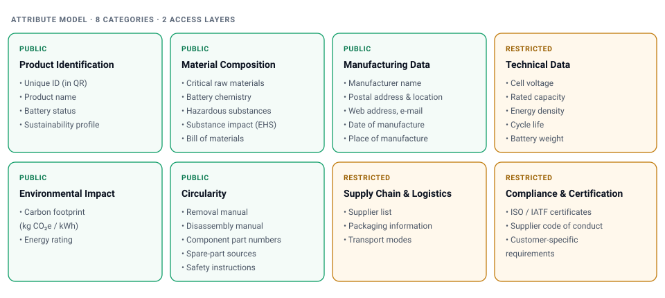

<div align="center">

# Digital Battery Passport · ID. Polo 37 kWh LFP

**An EU battery passport for the Volkswagen ID. Polo's lithium iron phosphate battery, mapped to Annex XIII of
Regulation (EU) 2023/1542. It is built only from public, cited sources and lists every attribute the manufacturer has not published.**

[](https://github.com/Kiran-koppera/digital-product-passport/actions/workflows/ci-deploy.yml)


### [▶ Live site](https://kiran-koppera.github.io/digital-product-passport/) · [Open the passport](https://kiran-koppera.github.io/digital-product-passport/passport.html?id=vw-id-polo-lfp-37) · [Data model](docs/data-model.md) · [Architecture](docs/architecture.md)



</div>

> **Independent case study.** This project is not issued, endorsed or verified by Volkswagen AG. Values come from
> public Volkswagen Group publications, the regulation text and cited literature, and each one is tagged with its
> provenance. The serial number, date of manufacture and state-of-health data are illustrative.

---

## The problem

From **18 February 2027** every EV battery placed on the EU market needs an electronic **battery passport**,
reachable through a QR code on the battery ([Regulation (EU) 2023/1542](https://eur-lex.europa.eu/eli/reg/2023/1542/oj), Art. 77).
Annex XIII sets what it must contain and who may read each part. The data is scattered across press kits,
sustainability reports and supplier documents, and much of it is not public at all.

This project builds that passport for a real battery and makes the gap visible.

## The battery

Volkswagen fits a **37 kWh (net) LFP battery** to the 85 kW and 99 kW versions of the ID. Polo (MEB+, front-wheel drive).

| | Value | Source |
|---|---|---|
| Chemistry | Lithium iron phosphate (LFP), cobalt- and nickel-free | [VW media drive, Sep 2026](https://www.volkswagen-newsroom.com/en/the-all-new-electric-id-polo-international-media-drive-20668/drive-system-versions-and-performance-data-20669) |
| Energy | 37 kWh net · 38.5 kWh installed | VW media drive · [VW Group, Martorell](https://www.volkswagen-group.com/en/articles/a-batterys-journey-20368) |
| Cells | 102 prismatic Unified Cells, co-developed with PowerCo | VW Group, Martorell · [PowerCo](https://www.powerco.de/en/product/unified-cell.html) |
| Architecture | Cell-to-pack, no module housings, three packs, load-bearing housing, about 10 % higher energy density | VW media drive · [VW, Dec 2025](https://www.volkswagen-newsroom.com/en/press-releases/reinventing-a-bestseller-id-polo-on-the-road-to-series-production-20032) |
| Charging | DC up to 88 kW (10–80 % in about 23 min) · AC 11 kW · Vehicle-to-Load up to 3.6 kW | VW media drive · [VW world premiere](https://www.volkswagen-newsroom.com/en/the-all-new-electric-id-polo-world-premiere-20343) |
| Range | WLTP 323–331 km, 13.6–13.8 kWh/100 km | VW media drive |
| Warranty | 8 years or 160,000 km, at least 70 % state of health | [VW Group battery FAQ](https://www.volkswagen-group.com/en/electric-car-battery-technology-19028) |
| Assembly | Battery system assembly, Workshop 20, SEAT & CUPRA plant Martorell, Spain | VW Group, Martorell |
| Due diligence | Raw Materials Due Diligence Management System (2020, OECD), ReSC, IRMA, annual Responsible Raw Materials Report | [VW Group supply chain](https://www.volkswagen-group.com/en/sustainability-in-the-supply-chain-16113) |
| Carbon footprint | **Not declared yet** (Art. 7). Indicative: about 75.5 kg CO₂e/kWh cradle-to-gate for an LFP pack (literature), so about 2.9 t CO₂e for this pack | [ESS News, Sep 2026](https://www.ess-news.com/2026/09/28/sodium-ion-packs-25-less-carbon-intensive-than-lfp-say-researchers/) |

Where Volkswagen's own publications disagree (for example DC power: 88 kW in September 2026, 90 kW in
April 2026), the passport uses the most recent value and records the discrepancy in a note.

## What the passport shows

| | Feature | Details |
|---|---|---|
| 🇪🇺 | **Annex XIII structure** | 10 sections and 86 attributes, each with its legal reference (Annex VI, Art. 7, 8, 52, 74, Annex IV, Annex VII). |
| 🔐 | **Encrypted restricted data** | Legitimate-interest and authority sections are published only as AES-256-GCM ciphertext (key from PBKDF2-SHA256, 600,000 iterations). The access password decrypts them in the browser. **Demo password: `1234`.** |
| 👥 | **Access groups** | Public · Legitimate interest (repairers, second-life operators, recyclers) · Authorities (notified bodies, market surveillance). The role switch shows what each group sees; locked sections name who may read them. |
| 🏷️ | **Provenance on every value** | Official · Derived · Regulation · Literature · Estimated · Simulated · Not disclosed, with numbered sources. |
| 🕳️ | **Gap report** | 22 attributes Volkswagen has not published, such as the Article 7 carbon footprint, cycle life, voltage limits, cell maker, part numbers and test reports. |
| 📈 | **Dynamic data** | A simulated BMS feed: state of health, full equivalent cycles and status, with a chart (Art. 14, Annex VII). |
| ⚖️ | **Chemistry-aware rules** | LFP contains no cobalt or nickel, so only lithium recycled content applies. The passport says so instead of showing 0 %. |
| 📱 | **Permanent QR code** | Encodes the final URL directly, with error correction Q. Decoded and checked on every build. |
| 🧾 | **Role-aware export** | The JSON export contains only what the current role may see. |

<table>
<tr>
<td width="50%"><br><sub>Landing page</sub></td>
<td width="50%"><br><sub>Viewed as legitimate interest (dark theme)</sub></td>
</tr>
</table>

## Try it

| Scan with your phone | Passport |
|:-:|---|
|  | Restricted sections: password **`1234`**<br>**[ID. Polo 37 kWh LFP Battery](https://kiran-koppera.github.io/digital-product-passport/passport.html?id=vw-id-polo-lfp-37)**<br>`VWAG-LFP37-20260914-004217-33`<br>[As a recycler](https://kiran-koppera.github.io/digital-product-passport/passport.html?id=vw-id-polo-lfp-37&role=legitimate-interest#composition) · [As an authority](https://kiran-koppera.github.io/digital-product-passport/passport.html?id=vw-id-polo-lfp-37&role=authority#conformity) · [Gap report](https://kiran-koppera.github.io/digital-product-passport/passport.html?id=vw-id-polo-lfp-37#gaps) |

## Data model



Every field carries `annex`, `value`, `unit`, `provenance`, `sources` and an optional `note`. CI enforces these rules:

- A `null` value must be tagged `not-disclosed`, and a `not-disclosed` field must be `null`.
- An `official` value needs a source.
- A `derived` or `estimated` value must explain its method.
- Every cited source must exist, and every listed source must be cited.

Details: [docs/data-model.md](docs/data-model.md).

```bash
python scripts/validate_data.py --gaps
# [ OK ] vw-id-polo-lfp-37  64/86 fields with a value · official 27, derived 7, regulation 8,
#                           literature 2, estimated 9, simulated 11, gaps 22
```

## Architecture


The site is a **static, serverless** application: plain HTML, CSS and ES modules on GitHub Pages, with one JSON
record per battery in this repository. A GitHub Actions pipeline validates the data, checks that the QR code is
current and decodes correctly, runs browser tests, deploys, and smoke-tests the live QR target.
More detail: [docs/architecture.md](docs/architecture.md).

## Getting started

```bash
git clone https://github.com/Kiran-koppera/digital-product-passport.git
cd digital-product-passport
python -m http.server 8000          # open http://localhost:8000
```

Development tooling:

```bash
pip install -r requirements-dev.txt
python scripts/validate_data.py --gaps   # schema + Annex XIII rules + gap report
python scripts/seal_passport.py          # encrypt restricted sections -> data/sealed/ (run after editing a record)
python scripts/generate_qr.py            # regenerate QR codes from the registry
python scripts/verify_qr.py              # decode-test every QR code (add --online for the live site)
python -m unittest discover -s tests

npm ci && npx playwright install chromium
npx playwright test                      # end-to-end tests, desktop + mobile
```

Scaffold another battery with `python scripts/new_passport.py <id> "<Name>" --uid <UID>`.

## Project structure

```
├── index.html, passport.html, labels.html, 404.html   # the site
├── assets/{css,js,img}/                               # styles, ES modules, icon
├── data/
│   ├── passports.json                                 # registry + Annex XIII access groups
│   ├── passports/vw-id-polo-lfp-37.json               # the passport record (plain-text source)
│   ├── sealed/vw-id-polo-lfp-37.json                  # published record, restricted sections encrypted
│   └── schema/passport.schema.json
├── qr/                                                # generated QR code (SVG + PNG)
├── scripts/                                           # scaffold, validate, generate & verify QR, screenshots
├── tests/                                             # Python unit tests + Playwright e2e
├── docs/                                              # architecture, data model, QR codes, deployment, diagrams
└── .github/workflows/ci-deploy.yml
```

## Scope

| Capability | Status |
|---|---|
| Annex XIII data model with provenance and sources | ✅ Implemented |
| Public data from Volkswagen Group publications | ✅ Implemented, with sources |
| Gap report against Annex XIII | ✅ Implemented |
| Encrypted restricted sections | ✅ AES-256-GCM in the published site, password `1234`. A 4-digit demo password can be brute-forced offline, and the plain-text source is in this public repo; production needs server-side identity and per-role keys. |
| Dynamic state-of-health data | ⚠️ Simulated |
| Article 7 carbon footprint declaration | ❌ Not published by Volkswagen. An indicative literature value is shown and labelled. |
| Legal compliance with Regulation (EU) 2023/1542 | ❌ Not claimed. Only the economic operator can issue a passport. |

## Background and credits

Started as a team project in the module *M7 Manufacturing Technology and Business Technology*, HTW Berlin
(milestone report 22 January 2026, presentation 27 January 2026).
**Team:** Shubham Kanawade, Sanchay Narain, Varad Shinde, Kiran Koppera. **Supervisor:** Prof. Dr. Christoph Sprung.
Rebuilt as an Annex XIII case study on a production LFP battery by Kiran Koppera.

Original documents: [milestone report](docs/original/DPP_MM03_Milestone-Report_2026-01-22.pdf) ·
[presentation](docs/original/DPP_MM03_Presentation_2026-01-27.pdf) ·
[original interface screenshots](docs/images/original-prototype/).

**References:** [Regulation (EU) 2023/1542](https://eur-lex.europa.eu/eli/reg/2023/1542/oj) ·
[Battery Pass – Content Guidance](https://thebatterypass.eu/assets/images/content-guidance/pdf/2023_Battery_Pass_Content_Guidance.pdf) ·
[Global Battery Alliance – Battery Passport](https://www.globalbattery.org/battery-passport/)

## License

Code: [MIT](LICENSE). Product names are the property of their owners and are used here only to identify the
subject of the case study. The documents in `docs/original/` are the project team's academic work and are included
for reference only.
