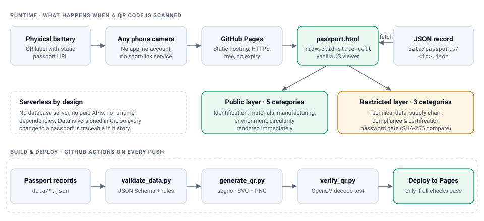

# Architecture



## Design goals

| Goal | Decision |
|------|----------|
| QR codes must never expire | Encode the final HTTPS URL directly in the QR code. No short-link or "dynamic QR" service sits in between. |
| Free, durable hosting | GitHub Pages: static files only, HTTPS, no server to maintain or pay for. |
| No hidden dependencies | Plain HTML, CSS and ES modules. No framework, no CDN, no web fonts, no analytics. |
| Every value is traceable | Each field carries a legal reference, a provenance tag and numbered sources. Each change is a Git commit. |
| Broken data never ships | CI validates data against the schema and the Annex XIII rules, checks the QR codes and runs browser tests before deploying. |

## Components

```
index.html            Landing page: passport preview, access groups, provenance, regulation timeline, UID decoder, scope
passport.html         Passport viewer, driven by ?id=<passport-id>[&role=<group>][#section-key]
labels.html           Printable QR label
assets/js/common.js   Theme, role state, provenance metadata, coverage helpers, icons
assets/js/passport.js Viewer: hero, key facts, provenance bar, sections, gap report, sources, export
assets/js/home.js     Landing page content rendered from data/, UID decoder
assets/js/uid.js      UID parser and CRC-8 check code
data/passports.json   Registry: access groups and passport ids
data/passports/*.json One record per battery (plain-text source, not deployed)
data/sealed/*.json    Published records: restricted sections encrypted (AES-256-GCM)
data/schema/          JSON Schema for records
qr/                   Generated QR codes (SVG + PNG), committed so they can be printed without tooling
scripts/              Python tooling: scaffold, validate (+ gap report), generate QR, verify QR, screenshots
tests/                Python unit tests and Playwright end-to-end tests
```

## Request flow

1. A phone camera reads the QR label and opens
   `https://kiran-koppera.github.io/digital-product-passport/passport.html?id=vw-id-polo-lfp-37`.
2. `passport.js` fetches `data/passports.json`, checks that the id exists, then fetches the record.
3. The page renders the identity card, key facts, the provenance summary, all ten sections, the gap report and
   the numbered sources.
4. Sections above the viewer's access group show a locked card that names the group allowed to read them.

## Access groups

| Group | Sections | Who (Annex XIII) |
|-------|----------|------------------|
| Public | Identification, carbon footprint, due diligence, recycled content, performance, end of life | Anyone |
| Legitimate interest | Detailed composition, repair & dismantling, state of health | Repairers, remanufacturers, second-life operators, recyclers, the Commission |
| Authorities | Conformity & test reports | Notified bodies, market surveillance authorities, the Commission |

**How it works.** `scripts/seal_passport.py` writes `data/sealed/<id>.json`: public sections in plain text, and
all restricted sections plus the state-of-health history as one AES-256-GCM ciphertext. The key is derived from the
access password with PBKDF2-SHA256 (600,000 iterations, random 16-byte salt), and the passport id is bound in as
additional authenticated data. Only the sealed file is deployed. The viewer decrypts it with the Web Crypto API when
the password is entered (demo password **`1234`**) and caches the derived key, not the password, in
`sessionStorage` for the session. The access switch in the header picks a role; a URL can carry
`&role=legitimate-interest` or `&role=authority`. The JSON export contains only what the current role can see.

**Limits.** One password unlocks every restricted section, so the role switch is still a view filter once the
data is decrypted. A 4-digit password can be brute-forced offline in a short time despite PBKDF2. The plain-text
source `data/passports/*.json` stays in this public repository so it can be reviewed and validated.

**What production would need.** Restricted sections would sit behind an API that checks the caller's identity
and role, for example OpenID Connect or eIDAS credentials mapped to the Annex XIII groups. Only the public layer
would be served statically. The record format would not change, because every section already carries its
`access` group.

## Why not a dynamic QR service?

The original prototype's QR codes were generated with a commercial "dynamic QR" service. They encoded short links
that redirected to the real page. When the subscription ended, the service deactivated the redirects and every
printed code stopped working.

Static codes that encode the final URL avoid this whole class of failure. The cost is that the URL has to be
stable. This is handled by a permanent, id-based URL scheme (`passport.html?id=<id>`), so the content behind an
id can change without reprinting the label. See [qr-codes.md](qr-codes.md).

## Testing strategy

| Level | Tool | What it proves |
|-------|------|----------------|
| Sealing | `seal_passport.py --check` | The sealed file decrypts with the password to exactly the current restricted sections, and leaks no restricted text |
| Data | `validate_data.py` (JSON Schema + rules) | Section order and access groups, provenance rules, every cited source exists and every source is cited, uid and status consistent |
| Unit | `python -m unittest` | The rules reject bad records; key published values stay as cited |
| QR | `verify_qr.py` | Every PNG decodes to exactly the right URL, also at 240 px and 160 px; every SVG references it |
| Browser | Playwright (desktop Chrome + Pixel 7) | Rendering, role switching and persistence, locked sections, provenance on every field, gap report, export redaction, no horizontal scroll |
| Live | `verify_qr.py --online` after deploy | Each QR target and its JSON return HTTP 200 |
