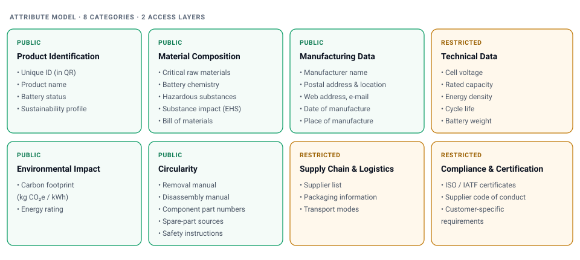
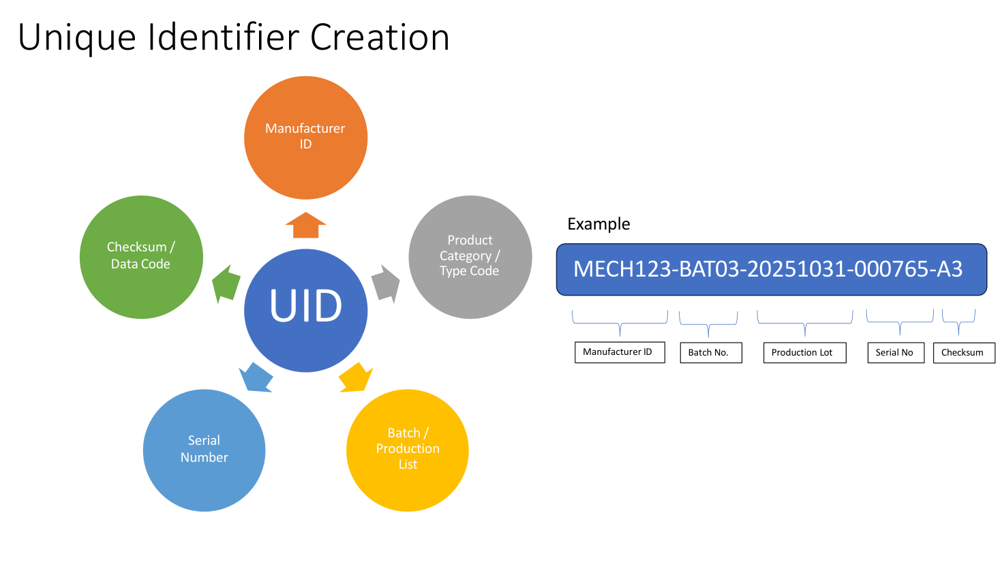

# Data model



The attribute model follows section 4.3 of the project report. The project derived it from the
[Battery Pass consortium content guidance](https://thebatterypass.eu/assets/images/content-guidance/pdf/2023_Battery_Pass_Content_Guidance.pdf)
and the battery passport concept in Regulation (EU) 2023/1542.

## Categories

| # | Key | Category | Access | Attributes |
|---|-----|----------|--------|------------|
| 1 | `product-identification` | Product Identification | Public | Unique ID, product name, product (battery) status: original / repurposed / reused / remanufactured, sustainability profile |
| 2 | `material-composition` | Material Composition | Public | Critical raw materials, battery chemistry, hazardous substances, impact of substances on environment / health / safety, bill of materials |
| 3 | `manufacturing-data` | Manufacturing Data | Public | Manufacturer name, postal address, web address, e-mail, date of manufacture, place of manufacture |
| 4 | `technical-data` | Technical Data | **Restricted** | Cell voltage, rated capacity, energy density, cycle life, battery weight |
| 5 | `environmental-impact` | Environmental Impact | Public | Carbon footprint (kg CO₂e / kWh), energy rating |
| 6 | `circularity` | Circularity & Resource Efficiency | Public | Removal manual, disassembly manual, component part numbers, spare-part sources, safety instructions |
| 7 | `supply-chain` | Supply Chain & Logistics | **Restricted** | Supplier list, packaging information, transport modes |
| 8 | `compliance` | Compliance & Certification | **Restricted** | ISO / IATF certificates, supplier code of conduct, customer-specific requirements |

## Record format

Each record (`data/passports/<id>.json`) is validated against
[`data/schema/passport.schema.json`](../data/schema/passport.schema.json):

```jsonc
{
  "id": "solid-state-cell",              // URL slug, encoded in the QR code
  "uid": "SSC123-BAT01-20260118-A3",     // unique product identifier (null if not assigned)
  "productName": "Solid State Cell",
  "recordStatus": "documented",          // or "placeholder"
  "source": "Where the values come from",
  "legacyQr": "https://qr.codes/byrKQP", // the deactivated QR link this record replaces
  "sections": [                          // exactly 8, in the order above
    {
      "key": "technical-data",
      "title": "Technical Data",
      "access": "restricted",
      "fields": [
        { "label": "Cell voltage", "value": "3.8 V" },
        { "label": "Battery chemistry", "value": null },          // null = pending
        { "label": "Hazardous substances", "value": ["Li metal", "NMC811 cathode"] },
        { "label": "Date of manufacture", "value": "2025-12-01", "format": "date" },
        { "label": "Energy rating", "value": "Carbon footprint performance class B" }
      ]
    }
  ]
}
```

Values are a string, a list of strings, or `null`. `null` means the attribute is part of the model but has
not been populated yet. The original prototype showed these as "To be add". The viewer shows them as
*Pending* and counts them in the completeness bar.

### Record status

| `recordStatus` | Meaning |
|---|---|
| `documented` | Fully populated passport. Validation requires every attribute to have a value. |
| `placeholder` | Structure only; all values `null`. Created by `scripts/new_passport.py`. |

The UIDs of the Lithium Ion, Sodium Ion and Sodium Chloride records follow the 5-part scheme with the CRC-8
check code proposed in this repository.

| Record | UID | Chemistry |
|---|---|---|
| Lithium Ion Battery | `LIC204-BAT02-20260112-000418-4C` | NMC622 / graphite, 21700 cylindrical cell |
| Sodium Ion Cell | `NAI310-BAT04-20260126-000932-AD` | Prussian white / hard carbon, prismatic cell |
| Sodium Chloride Battery | `ZNC075-BAT05-20260109-000057-76` | Sodium–nickel chloride (ZEBRA), β″-alumina electrolyte |

## Unique identifier

From presentation slide 3 and report §4.1:



```
MECH123 - BAT03 - 20251031 - 000765 - A3
   │        │        │         │       └─ checksum / data code
   │        │        │         └───────── serial number
   │        │        └─────────────────── production lot (date, YYYYMMDD)
   │        └──────────────────────────── product category / type (batch) code
   └───────────────────────────────────── manufacturer ID
```

Notes:

- The slide labels the second segment "Batch No.", while the circle diagram on the same slide lists
  "Product Category / Type Code". The decoder shows both meanings.
- The documented Solid State Cell UID `SSC123-BAT01-20260118-A3` has four segments, with no serial number.
  It is kept as documented, and the decoder flags the missing segment.
- The checksum algorithm was not specified. All documented examples end in `A3`. As a clearly labelled
  extension, the decoder shows a CRC-8 (polynomial 0x07) check code computed over the UID body.

## Data provenance for the Solid State Cell

All values were transcribed from the interface screenshots in the presentation, slides 4 and 6–12
([original screenshots](images/original-prototype/)). Normalisations:

| Original | In this repo | Reason |
|----------|--------------|--------|
| `01-12-2025` | `2025-12-01` | ISO 8601 date |
| "To be add" | Completed with a value for the chemistry | Full 33-attribute passport |
| E-mail `xyz@gmail.com` | `dpp@solidstate-battery.de` | The original was a placeholder |
| Web address "To be decided" | `https://www.solidstate-battery.de` | Not populated in the prototype |
| Weight "> 196.54 g", energy density "350–380 Wh/kg", cycle life "> 1000 cycles" | 52.5 g, 362 Wh/kg, 1,050 cycles | Exact values, consistent with 5.0 Ah × 3.8 V = 19 Wh |
| EU Battery Regulation "Link text" | Link to Regulation (EU) 2023/1542 on EUR-Lex | The prototype link had no visible target |

Supplier names (Umicore, Norilsk Nickel, Eramet, Glencore, Fraunhofer IKTS) are shown exactly as listed in the
prototype.

## Adding or completing a passport

```bash
python scripts/new_passport.py nmc-pack-01 "NMC Pack 01" --uid MECH123-BAT03-20260201-000001-A3
# edit data/passports/nmc-pack-01.json, set "recordStatus": "documented"
# add {"id": "nmc-pack-01", "productName": "NMC Pack 01"} to data/passports.json
python scripts/validate_data.py
python scripts/generate_qr.py && python scripts/verify_qr.py
```
