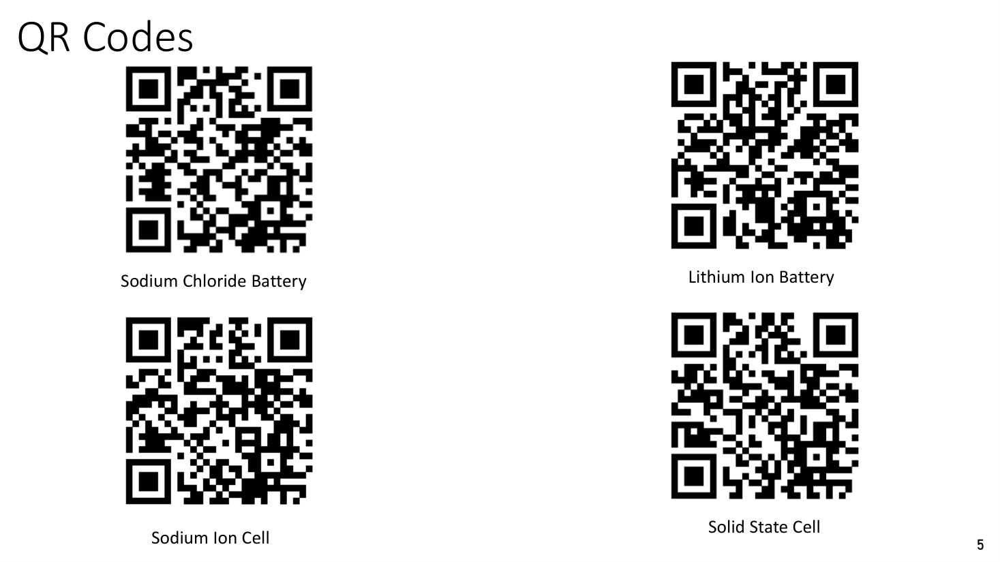
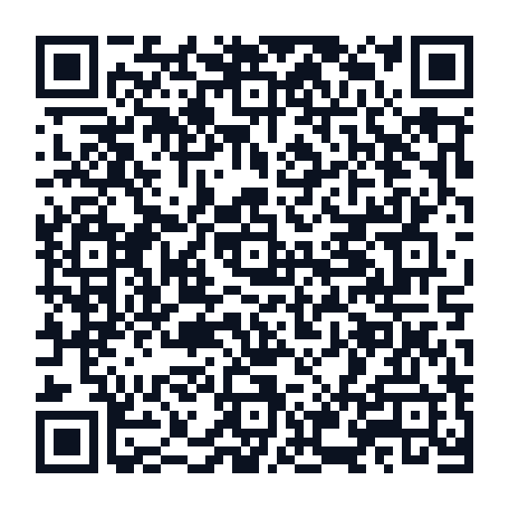
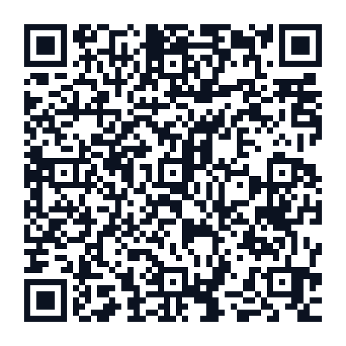
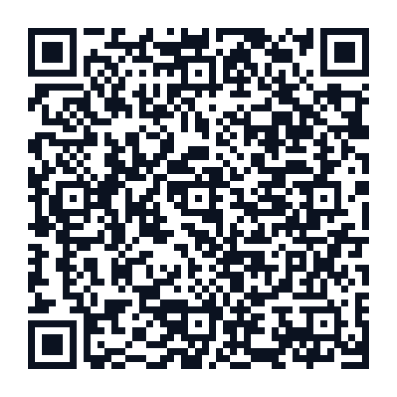
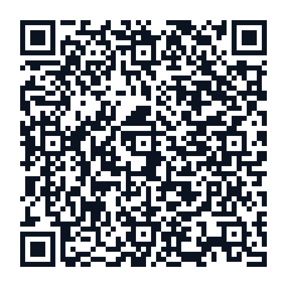

# QR codes

## What went wrong with the original codes

The presentation (slides 4–5) contained four QR codes. Decoding them gives:

| Battery | Original QR target | Status (checked Nov 2026) |
|---------|--------------------|---------------------------|
| Solid State Cell | `https://qr.codes/byrKQP` | Deactivated: "The QR code owner needs to choose a plan to reactivate this QR code." |
| Lithium Ion Battery | `https://qr.link/ya3G9m` | Deactivated (same message) |
| Sodium Ion Cell | `https://qr.codes/WBPwcU` | Deactivated (same message) |
| Sodium Chloride Battery | `https://qr.codes/kc3pva` | Deactivated (same message) |

These were *dynamic* QR codes. The printed pattern only contains a short link owned by the QR vendor, which then
redirects to the real page. When the subscription ends, the redirect stops and the printed codes no longer work.



## The replacement

| Property | Value |
|----------|-------|
| Generator | [segno](https://github.com/heuer/segno) 1.6.6 (pure Python, BSD-3-Clause, no network) |
| Encoded content | Final URL, e.g. `https://kiran-koppera.github.io/digital-product-passport/passport.html?id=solid-state-cell` |
| Symbol | QR Code Model 2, version 8, error correction **Q** (~25 % damage tolerance), 4-module quiet zone |
| Formats | `qr/<id>.svg` (vector, for web and print) and `qr/<id>.png` (912 × 912 px) |
| Expiry / cost | None. No third party is involved at scan time. |

| Solid State Cell | Lithium Ion Battery | Sodium Ion Cell | Sodium Chloride Battery |
|:-:|:-:|:-:|:-:|
|  |  |  |  |

## Keeping the codes permanent

A static QR code is only as permanent as the URL it encodes. Three rules keep these codes working:

1. **Stable ids.** `?id=solid-state-cell` must keep resolving. Content can change freely; the id must not.
2. **Stable host.** The codes depend on the repository name `digital-product-passport` and the account
   `Kiran-koppera`. Renaming either breaks the codes. GitHub redirects renamed repositories, but not Pages URLs.
   If you need to move, deploy a redirect page at the old location or use a custom domain (see below).
3. **Regenerate after changes.** Changing `BASE_URL` in `scripts/dpp_model.py` requires
   `python scripts/generate_qr.py`. CI fails if the committed codes do not match the data.

**Optional: custom domain.** With a domain you own (e.g. `dpp.example.com` set as the Pages custom domain),
the codes become independent of GitHub. Change `BASE_URL`, regenerate the codes, and the site can later move to
any static host without reprinting labels.

## Verification

```bash
python scripts/verify_qr.py           # offline: decode every PNG at full size, 240 px and 160 px
python scripts/verify_qr.py --online  # also: every QR target and JSON record returns HTTP 200 live
```

Both run in CI. The online check runs after each deployment.
